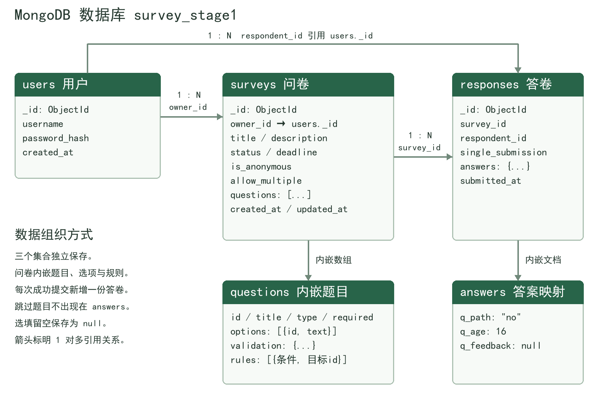

# 第一阶段数据库设计

数据库名：`survey_stage1`。三个集合分别是 `users`、`surveys`、`responses`。实际基础字段校验见项目根目录 [schema.json](https://github.com/shadawwuegidua/MDMS_Course_2026Fall/blob/main/schema.json)，由 [db.py](https://github.com/shadawwuegidua/MDMS_Course_2026Fall/blob/main/db.py) 在新集合创建时应用。

本文件说明已实现的数据组织方式。页面、接口、校验、跳转和统计均已接入这些集合，具体检查见 [测试报告 PDF](https://github.com/shadawwuegidua/MDMS_Course_2026Fall/blob/main/docs/pdf/%E6%B5%8B%E8%AF%95%E6%8A%A5%E5%91%8A.pdf)。

## 集合划分

| 集合 | 主要字段 | 用途 |
|---|---|---|
| users | `_id`、`username`、`password_hash`、`created_at` | 账号与注册时间，密码仅存哈希。 |
| surveys | `_id`、`owner_id`、`title`、`description`、`status`、`is_anonymous`、`allow_multiple`、`deadline`、`questions`、`created_at`、`updated_at` | 问卷设置、题目和规则；`owner_id` 指向创建者。 |
| responses | `_id`、`survey_id`、`respondent_id`、`single_submission`、`answers`、`submitted_at` | 每次成功提交一份独立答卷，关联问卷和填写账号。 |

三个集合的 `_id` 和账号、问卷引用均使用 MongoDB `ObjectId`。日期使用 UTC BSON Date，显示时再转换为本地时间。`deadline` 为 `null` 表示不设截止时间。问卷状态为 `draft`、`published`、`closed`。

MongoDB 不自动提供外键约束，后端需检查关联记录存在、当前用户权限和问卷状态。

## 数据结构图



`users._id` 对应问卷的 `owner_id` 和答卷内部的 `respondent_id`；`surveys._id` 对应答卷的 `survey_id`。连线表示保存标识后的逻辑关联，不表示 MongoDB 自动维护外键。题目、选项、校验和规则使用嵌入文档。

```text
surveys 文档
└─ questions[]
   ├─ id / title / type / required
   ├─ options[] → id / text
   ├─ validation → 数量、长度或数值限制
   └─ rules[] → operator / value / target_id
responses 文档
└─ answers → 以题目标识为键保存有效答案
```

## 题目嵌入问卷

`questions` 是数组，顺序就是题目默认顺序。每题包含稳定的字符串 `id`，答案和跳转都引用该标识，避免把题目序号当作身份。

```json
{
  "id": "q_age",
  "title": "你的年龄",
  "type": "number",
  "required": true,
  "options": [],
  "validation": {"min_value": 0, "max_value": 120, "integer_only": true},
  "rules": [{"operator": "lt", "value": 18, "target_id": "q_student"}]
}
```

四种内部题型名为 `single`、`multiple`、`text`、`number`，对应单选、多选、文本填空、数字填空。选择题的 `options` 使用 `{"id": "opt_a", "text": "选项文字"}`；答案保存选项标识而非显示文字。

`validation` 保存多选数量、文本长度或数字范围；`rules` 按顺序保存比较方式、比较值和目标题目标识。字段类型由 MongoDB 约束；选项是否存在、限制是否合理、目标是否在后面，以及答案与题型是否匹配，由后端检查。

## 答卷结构与统计

`answers` 是以题目标识为键的文档，例如：

```json
{
  "q_gender": "opt_a",
  "q_fruits": ["opt_apple", "opt_banana"],
  "q_age": 20,
  "q_comment": "示例意见"
}
```

这里只保存最终作答路径上的题目。路径上的选填题若留空，保存 `null`；跳过的题目不出现。`respondent_id` 用于内部判断重复填写，匿名问卷的管理及统计接口不得向创建者输出身份。

统计由后端读取 MongoDB 中的已提交答卷后计算，不另外维护统计集合或计数副本，避免答卷与统计不一致。演示问卷还有可选的 `demo_tag` 标记，供初始化脚本识别已经生成的样例，不改变正式业务结构。

## 索引

除 MongoDB 自动创建的 `_id` 索引外，初始化时创建四个索引：

| 集合 | 索引 | 原因 |
|---|---|---|
| users | 用户名唯一索引 | 防止账号重名。 |
| surveys | 创建者与创建时间 | 支持按用户查询问卷列表。 |
| responses | 问卷与提交时间 | 支持查询某问卷答卷及统计。 |
| responses | 问卷与填写者的部分唯一索引 | 仅约束 `single_submission=true` 的答卷，防止不允许重复时并发提交出两份。 |

后端根据已发布问卷设置写入 `single_submission = not allow_multiple`，不能相信客户端提供的该字段。允许重复时不受这项唯一约束，每份答卷均独立保存。发布后重复填写设置随题目规则一起固定。

## 为什么适合 MongoDB

题目、选项、校验和跳转规则通常随问卷一起读取，而且不同题型需要不同配置。将它们嵌入问卷文档，可自然表达数组及嵌套结构，一次取得完整定义。

用户独立存在，答卷数量又会持续增长，因此它们使用独立集合。这样不会把所有业务数据或不断增加的答卷都堆在一个大文档中。

系统不机械地为题目、选项、规则分别拆表，也不在每份答卷中复制整份问卷定义。问卷发布后固定题目和规则，答案通过稳定标识与之对应。

[schema.json](https://github.com/shadawwuegidua/MDMS_Course_2026Fall/blob/main/schema.json) 是结构层的校验，不能替代业务规则校验；后端 [logic.py](https://github.com/shadawwuegidua/MDMS_Course_2026Fall/blob/main/logic.py) 继续检查有效选项、实际作答路径、校验范围和规则目标等业务条件。

## 用 mongosh 查看与核对

以下命令只读，不创建、更新或删除数据。先按运行说明启动数据库并生成演示样例，再在 PowerShell 中连接：

```powershell
mongosh "mongodb://127.0.0.1:27017/survey_stage1"
```

后续均在 `mongosh` 内执行。先确认数据库和三个集合，使用投影只显示关心的用户字段：

```javascript
db.getName()
show collections
db.users.find({}, { _id: 1, username: 1, created_at: 1 })
```

投影中的 `1` 表示保留该字段，因此不会显示密码哈希。通过演示标记取得一份问卷；变量赋值只发生在命令行内存中，不写回数据库：

```javascript
var demo = db.surveys.findOne(
  { demo_tag: "stage1_walkthrough_v1" },
  { title: 1, owner_id: 1, status: 1, is_anonymous: 1,
    allow_multiple: 1, deadline: 1, questions: 1 }
)
demo
```

如果结果是 `null`，先完成演示初始化，不要继续使用 `demo._id`。找到后，既可通过 `owner_id` 查看归属，也可查看嵌入的题目、规则和关联答卷：

```javascript
db.users.findOne(
  { _id: demo.owner_id },
  { _id: 1, username: 1, created_at: 1 }
)
demo.questions.map(q => ({
  id: q.id, title: q.title, type: q.type,
  options: q.options, validation: q.validation, rules: q.rules
}))
db.responses.find(
  { survey_id: demo._id },
  { _id: 1, answers: 1, submitted_at: 1 }
).sort({ submitted_at: 1 })
```

这些答卷查询不投影 `respondent_id`，方便只对照答案。匿名问卷在应用中隐藏身份，但数据库内部仍保留账号关联以判断重复；本机直接访问数据库与应用账号权限是不同层次。

### 区分选填留空与跳过

演示答卷中，`q_feedback: null` 表示到达选填意见题后留空；没有 `q_fruits` 字段则表示整道水果题被跳转规则跳过。下面分别查看这两种情况：

```javascript
db.responses.find(
  { survey_id: demo._id, "answers.q_feedback": { $exists: true, $eq: null } },
  { _id: 0, answers: 1 }
)
db.responses.find(
  { survey_id: demo._id, "answers.q_fruits": { $exists: false } },
  { _id: 0, answers: 1 }
)
```

仅写 `{ "answers.q_feedback": null }` 会同时匹配显式 `null` 和字段不存在；因此第一条加 `$exists: true` 以只选出显式空值。应用统计时，两种情况均不计入该题有效回答人数。

### 查看实际校验器和索引

```javascript
printjson(db.getCollectionInfos().map(c => ({
  name: c.name, validator: c.options.validator
})))
db.users.getIndexes()
db.surveys.getIndexes()
db.responses.getIndexes()
```

应能看到三个集合的 `$jsonSchema`，以及前文列出的四个业务索引和各集合默认的 `_id` 索引。答卷部分唯一索引的 `partialFilterExpression` 应为 `{ single_submission: true }`。校验器规定基础结构，跨题目的条件与作答路径仍由后端检查。

### 独立核算数字平均值

```javascript
db.responses.aggregate([
  { $match: { survey_id: demo._id, "answers.q_age": { $type: "number" } } },
  { $group: { _id: null, answered: { $sum: 1 }, average: { $avg: "$answers.q_age" } } },
  { $project: { _id: 0, answered: 1, average: 1 } }
])
```

`$match` 只选择当前问卷中确有数值年龄的答卷，`$group` 用 `$sum` 计数、用 `$avg` 求平均，`$project` 整理显示字段。演示脚本初始两份答案是 20 和 16，因此未追加答卷时结果为 `answered: 2`、`average: 18`。这可与网页上的年龄统计互相核对；新增答卷后按实际数据重新计算。

运行与样例来源：[README](https://github.com/shadawwuegidua/MDMS_Course_2026Fall/blob/main/README.md)、[演示生成脚本](https://github.com/shadawwuegidua/MDMS_Course_2026Fall/blob/main/scripts/seed_demo.py)、[演示问卷配置](https://github.com/shadawwuegidua/MDMS_Course_2026Fall/blob/main/samples/demo_survey.json)；逐步操作见 [技术讲解与检查指南 PDF](https://github.com/shadawwuegidua/MDMS_Course_2026Fall/blob/main/docs/pdf/%E6%8A%80%E6%9C%AF%E8%AE%B2%E8%A7%A3%E4%B8%8E%E6%A3%80%E6%9F%A5%E6%8C%87%E5%8D%97.pdf)。
