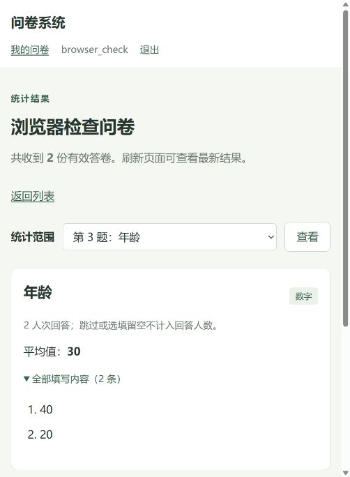

# 第一阶段测试报告

测试日期：2026-10-22。

本项目进行了业务逻辑单元测试、真实 MongoDB 集成测试和实际浏览器操作检查。现有自动化测试共 **49 项，全部通过**；浏览器检查另外记录，不计入这 49 项。

## 环境与结果

环境为 Windows、Python 3.12.7、Flask 3.1.3、PyMongo 4.19.0、MongoDB 8.3.11。Python 依赖在项目 `.venv` 内安装，版本见根目录 `requirements.txt`。

| 检查层次 | 内容 | 本次实际结果 |
|---|---|---|
| 单元测试 | 题目配置、答案校验、跳转路径及统计计算 | 23 项通过，0.002 秒。 |
| 集成测试 | Flask 请求、登录权限、真实 MongoDB 保存与查询、并发和状态变化 | 26 项通过，3.742 秒。 |
| 浏览器检查 | 实际页面创建、编辑、填写、错误提示、跳转、提交和统计 | 完成下述操作检查，结果符合预期。 |

耗时是本次运行记录，不作为性能指标。完整自动化输出保存在同目录 `测试原始输出.txt`。

## 如何运行自动化测试

在项目根目录打开 PowerShell，按 README 安装依赖并启动 MongoDB，然后分别运行：

```powershell
.\.venv\Scripts\python.exe -m unittest discover -s tests -p test_logic.py -v
.\.venv\Scripts\python.exe -m unittest discover -s tests -p test_app.py -v
```

第一条直接检查纯业务函数，不连接数据库。第二条连接真实 MongoDB，不依赖先启动网页服务；它通过 Flask 测试客户端发送请求，并自动初始化所需集合和索引。

集成测试使用随机命名的 `survey_stage1_tests_<随机标识>` 数据库。结束时核对完整名称、前缀和标识长度，仅删除本次测试数据库，不使用或清空正常项目数据库 `survey_stage1`。

## 作业六类要求的代表用例

表中列出代表性步骤、输入、预期和实际结果；其余具体用例见两个测试源文件。

| 类别 | 步骤与代表输入 | 预期结果 | 实际结果 |
|---|---|---|---|
| 创建问卷 | 登录后向创建接口提交标题、说明、匿名和重复填写设置以及单选题；再读取问卷和自己的列表。 | 返回 201，数据库中存在草稿，设置保持一致，出现在创建者列表中。 | 通过；并确认另一账号的列表不含该问卷。 |
| 添加题目 | 对草稿提交单选、多选、文本、数字四种题目，再重新读取。 | 保存成功，四种类型和已有题目标识保持一致。 | 通过；数据库及接口读回内容与配置一致。 |
| 跳转逻辑 | 单选选甲跳到结束题；多选包含甲触发跳转；数字填写 16，按小于 18 跳转；未到达的必答题不提供有效答案。 | 三类条件均生效；跳过的必答题不阻止提交，其残留答案不保存。 | 通过；另检查未命中按顺序前进、多条命中取第一条、向前或不存在的目标被拒绝。 |
| 答案校验 | 必答单选留空、伪造选项；要求恰好选 2 个却只选 1 个或重复同一选项；文本过长；年龄输入 121、1.5、非数字。 | 请求返回 400，错误答案不写入答卷集合。 | 通过；上述错误尝试后的答卷数为 0，合法答案随后可以提交。 |
| 提交问卷 | 发布后提交有效的单选、多选、文本和数字答案，再读取真实数据库中的答卷。 | 返回 201，保存一份独立答卷，值按题型规范化；未知题号或错误答案结构不能提交。 | 通过；同时验证逐题检查接口只校验并返回下一题，不提前创建答卷。 |
| 统计结果 | 提交两份已知答案：单选甲/乙，多选甲/甲乙，文本“第一份”/“第二份”，数字 10/30，选填文本留空。 | 总答卷 2；单选各 1；多选甲 2、乙 1；可见两份文本；数字平均 20；空选填回答人数为 0。 | 全部一致；按题号筛选时仅返回选定题目的统计。 |

## 权限、状态与并发补充检查

- **账号与请求权限**：密码以哈希保存；错误密码登录失败；未登录的业务 API 返回 401；缺少 CSRF 令牌的修改请求返回 400；其他用户访问问卷管理、编辑、发布、关闭、截止设置及统计接口返回 404。
- **匿名与具名**：匿名统计明细仅标记“匿名”，不输出填写者用户名和账号 ID；系统内部仍保存账号关联以判断重复。具名问卷明细能够显示填写者用户名。
- **发布与关闭**：空问卷不能发布；发布后不能替换题目定义；关闭或已截止时不能提交，已有答卷和统计仍保留。调整截止时间的检查通过。
- **配置可作答性**：必答多选最多选 0 项、必答文本最长 0 个字符会被拒绝；相同选填配置仍允许留空，避免发布无法回答的必答题。
- **重复与多人提交**：禁止重复时，同一账号连续第二次提交被拒绝；5 个并发请求仅 1 个返回 201，其余 4 个返回 409，数据库只有 1 份答卷。允许重复时，5 个并发请求均返回 201，数据库保存 5 份独立答卷。
- **发布竞态回归**：在发布校验完成、最终写入之前，通过一次真实 MongoDB 更新模拟另一标签页清空草稿。发布返回 409，数据库状态仍为 `draft`、题目为空，公开读取和提交均被拒绝，没有生成答卷。这验证了题目在检查后发生变化时，原子发布条件会拒绝写入。测试仅使用函数调度钩子控制交错，不模拟数据库返回结果。

## 实际浏览器操作检查

使用正常项目数据库中的账号 `browser_check`，通过页面创建“浏览器检查问卷”，包含单选、多选、数字年龄和文本四题。年龄限制为 0—120 的整数，文本长度限制为 2—20 个字；单选选“跳过多选”时跳到年龄题。

实际操作中，空必答题显示错误；年龄输入 121 显示越界错误；文本只输入“好”时显示过短错误。修正后提交两份答卷，年龄分别为 20、40。第一份跳过多选，第二份选择苹果和香蕉。

统计页实际显示总答卷 2 份、单选两项各 1 人、多选回答 1 人且苹果和香蕉各 1 次、年龄平均值 30；匿名明细和单题筛选显示正确。

截图：



浏览器检查验证真实页面和 JavaScript 交互，自动化测试则用于重复验证业务规则、接口、持久化和边界条件，两者相互补充。

## 范围与限制

本报告记录已实际执行的检查，不表示穷尽全部输入或达到百分之百代码覆盖率。没有进行大规模压力、长时间稳定性、跨浏览器或公网部署测试；这里的 5 请求并发检查只验证本次提交行为。第二阶段的题库、共享、版本管理和跨问卷统计不在第一阶段测试范围内。

自动化测试数据库已清理。正常项目数据库中的浏览器检查问卷及两份答卷保留，便于人工复查和对照理解，不混入自动化用例的统计。

## 演示数据核对

`scripts/seed_demo.py` 已实际执行并重复执行检查。第二次没有增加或覆盖记录；五题演示问卷保留两份答卷，年龄 20、16 的平均值为 18，水果仅 1 人次回答，苹果、香蕉、橙子次数分别为 1、1、0，匿名显示正确。该演示问卷与浏览器检查问卷是两份不同问卷，初始数据用于检查指南。
